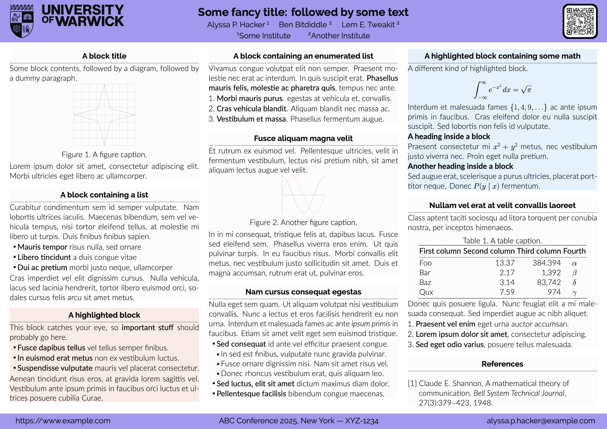
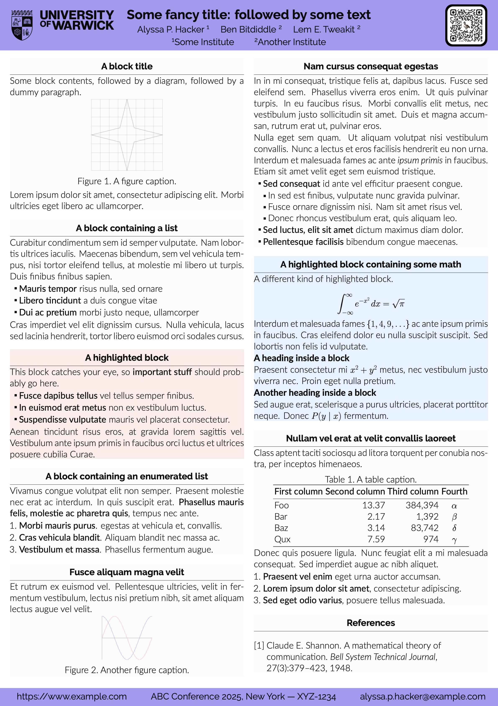

# Gemini (Warwick)

Gemini is a modern LaTeX [beamerposter] theme.

## Dependencies

- Select `LuaLaTeX` as the compiler.
- To use `Makefile`, `latexmk` is needed.

## Usage

### Landscape

Use [poster-landscape.tex](poster-landscape.tex), or run `make landscape`

### Portrait

Use [poster-portrait.tex](poster-portrait.tex), or run `make portrait`

## Acknowledgement

This project is build on [gemini](https://github.com/anishathalye/gemini).

## License

[MIT License](LICENSE.md)
