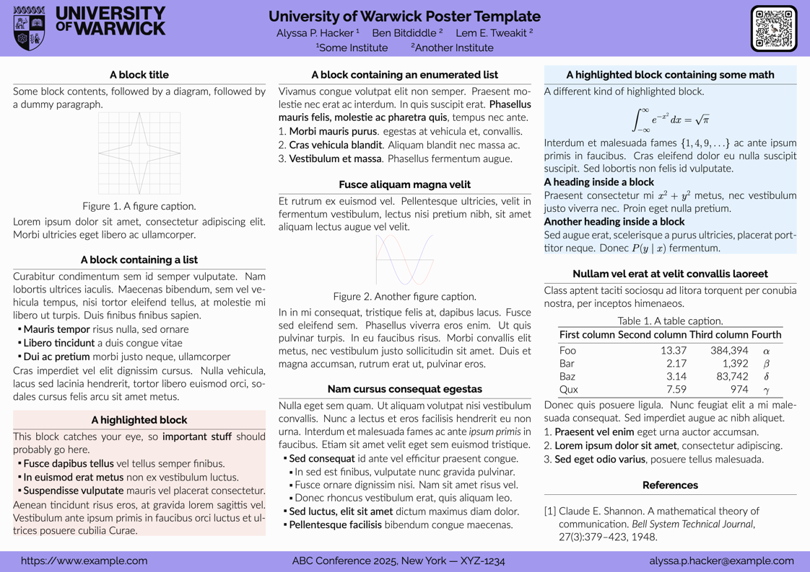
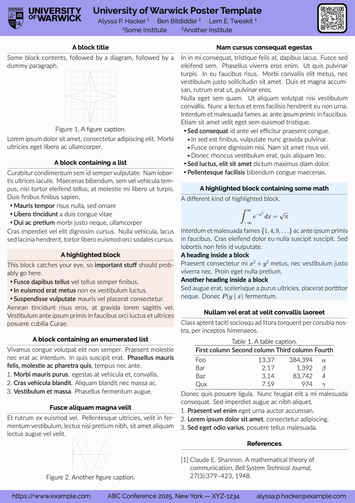

# University of Warwick Poster Template

- A LaTeX beamerposter theme adapted from [gemini](https://github.com/anishathalye/gemini).
- Uses the University of Warwick's [official colours](https://brand.warwick.ac.uk/en/brand-guidelines/design-elements/).
- Provides both landscape and portrait templates.

## Dependencies

### Overleaf

- [Click to create a new project on Overleaf](https://www.overleaf.com/docs?snip_uri=https://github.com/xuefeng-xu/gemini/archive/refs/heads/warwick.zip&engine=lualatex)

### Build locally

- Select `LuaLaTeX` as the compiler.
- To use `Makefile`, `latexmk` is needed.

## Usage

### Landscape

Use [poster-landscape.tex](poster-landscape.tex), or run `make landscape`

### Portrait

Use [poster-portrait.tex](poster-portrait.tex), or run `make portrait`

## Acknowledgement

This project is build on [gemini](https://github.com/anishathalye/gemini).

## License

[MIT License](LICENSE.md)
